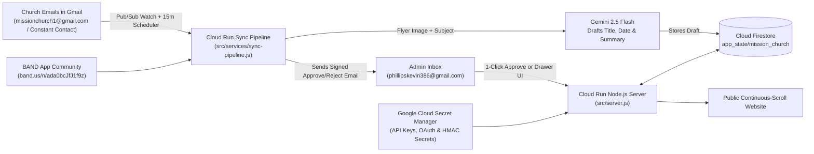

# Mission Church COOLJC · Continuous-Scroll Web App & Google Cloud Platform

Modern, responsive website, AI Church Concierge, and automated event/newsletter ingestion backend for **Mission Church of Our Lord Jesus Christ** (130 Highland Avenue, Somerville, MA 02143).

- **Live Shareable Public URL (Next-Gen MVP):** https://mission-church-web-5jdy3d7zua-uc.a.run.app
- **Alternate Canonical Cloud Run URL:** https://mission-church-web-687901748717.us-central1.run.app
- **Live WordPress Production Site Powered by This Harness:** https://missionchurchcooljc.com
- **WordPress Agentic Wrapper & Overhaul Portfolio Repo:** https://github.com/phillipsk/mission-wp-agentic-harness

> [!NOTE]
> **Hybrid Production Role:** While the next-generation native web frontend (`mission-web`) incorporates Board of Technology feedback (white-forward palette, modern SVG emblem, 3-short homepage limit, strictly upcoming events slider, dedicated ministry subpages) and scales to zero at **~\$0.14/month idle**, its **Google Cloud Run backend + 15-minute Cloud Scheduler (`mission-church-watch-poll`) + Gemini 2.5 Flash Multimodal Orchestrator** actively serves as the **Agentic Automation Harness** for `https://missionchurchcooljc.com`! Incoming emails from `missionchurch1@gmail.com` / flyers / BAND posts are triaged into `recurring_event` (skipped), `special_event` (WordPress Post + M.E. Calendar Event), or `announcement_post` (WordPress Post only), redacted for public privacy, paired with dual Original + Gemini AI graphics, emailed for 1-click approval, and published via HMAC-SHA256 to `/wp-json/mission/v1/publish`.

---

## 1. Tech Stack

- **Frontend:** Semantic HTML5, responsive CSS3 (Desktop, Tablet `768px`, and Mobile `390px` preview switcher + mobile bottom bar), and zero-framework Vanilla ES Modules (`public/`).
- **Backend API & Streaming:** Node.js `>=20` HTTP server (`src/server.js`) with HTTP `206 Partial Content` Range streaming for downloaded Facebook Worship Shorts (`/assets/shorts/*.mp4`) and REST endpoints.
- **AI Concierge & Multimodal Flyer Drafting:** Google **Gemini 2.5 Flash** (`src/services/gemini-concierge.js`, `src/services/sync-pipeline.js`) grounded on live schedules, Zoom credentials, ministries, and visitor FAQs.
- **Database:** **Google Cloud Firestore** (Native mode, `nam5` location) persisted via `src/services/firestore-store.js`.

---

## 2. Backend Infrastructure & Data Flow



### Cloud Components (All Hosted on Google Cloud)

1. **Google Cloud Run (`mission-church-web`, `us-central1`):** Runs the containerized Node.js application (`Dockerfile`). Scales automatically to zero when idle and wakes on traffic.
2. **Google Cloud Firestore (`(default)` database, `nam5`):** Stores live mutable state in `app_state/mission_church`, including published `feed` posts, `pendingPosts` awaiting admin approval, `processedSourceIds`, `prayerWall` requests and Amen counts, `ministrySubmissions`, `visitPlans`, and `syncState`.
3. **Google Cloud Secret Manager:** Injects sensitive credentials as runtime environment variables (`GEMINI_API_KEY`, Gmail OAuth credentials, and `APPROVAL_HMAC_SECRET`) without storing any secrets in Git.
4. **Cloud Pub/Sub (`mission-church-gmail-watch` → `mission-church-gmail-push-sub`) & Cloud Scheduler (`mission-church-watch-poll`, every 15 minutes):** Watches for incoming Mission Church emails and triggers `/api/admin/watch-poll` to draft new posts automatically.

---

## 3. Caching Strategy & Version Control

### How the Backend Is Cached
- **API Responses (`/api/*`):** Every API endpoint sends `Cache-Control: no-store`. Whenever you approve a drafted post, someone adds a Prayer Wall request, or a ministry form is submitted, all visitors see the updated state on their next load with zero stale API cache.
- **Database Reads/Writes:** `src/services/firestore-store.js` reads/writes directly to Cloud Firestore (`app_state/mission_church`) and caches only the GCP OAuth access token in memory until ~60 seconds before expiry. It also writes a local fallback copy to `src/data/church-data.json` for offline local testing.
- **Video Shorts (`/assets/shorts/*.mp4`):** Served with `Accept-Ranges: bytes` and HTTP `206 Partial Content` streaming so mobile and desktop browsers buffer and scrub videos smoothly without downloading the entire file upfront.

### What Lives in Version Control (GitHub) vs. Cloud Runtime
- **Tracked in GitHub (`phillipsk/mission-church-web`):**
  - All application source code (`src/`, `public/`, `scripts/`, `Dockerfile`, `.github/workflows/deploy-cloud-run.yml`).
  - Baseline church photography, flyers, downloaded Facebook Worship Shorts, and the initial seed snapshot (`src/data/church-data.json`).
- **NOT Tracked in GitHub (Protected Outside Version Control):**
  - `.env`, `.env.local`, and `local.properties` are ignored via `.gitignore` and `.dockerignore`.
  - Production secrets live in **Google Cloud Secret Manager** (`MISSION_CHURCH_GEMINI_API_KEY`, `MISSION_GMAIL_*`, `MISSION_APPROVAL_SECRET`, `MISSION_ADMIN_PASSCODE`) and the GitHub Actions deployment credential lives in GitHub Secrets (`GCP_SA_KEY`).
  - Live runtime user submissions, newly approved posts, and Prayer Wall updates live in **Cloud Firestore**, so redeploying code from GitHub never overwrites live church data.

---

## 4. Admin Portal (`/login`) & BAND + Gmail Post Ingestion Workflow

### Admin Authentication (`/login`, `/admin`, `/wp-admin`)
- Regular visitors see only the public continuous-scroll website; `pendingPosts`, `ministrySubmissions`, and `visitPlans` are redacted from `/api/bootstrap` unless authenticated.
- Church administrators (`phillipskevin386@gmail.com`, `missionchurch1@gmail.com`, `flips4063@gmail.com`) visit `/login` (or `/admin` / `/wp-admin`, just like WordPress) to sign in via either **Admin Passcode** or a **1-Click Email Login Link / 6-Digit Code** delivered through Gmail.
- Successful login issues an `HttpOnly`, HMAC-SHA256 signed `mission_admin_session` cookie (valid 7 days) and opens the **Admin Studio** drawer (`/?admin=1`).

### BAND App Text + Overall Description + Image Extraction & Approval Flow
1. **Detection:** Cloud Pub/Sub (`POST /api/webhooks/gmail-push`) or Cloud Scheduler (`POST /api/admin/watch-poll` every 15 minutes) monitors Mission Church emails (`missionchurch1@gmail.com` / Constant Contact / `band.us`) and BAND community feeds.
2. **Multimodal BAND & Email Parsing:** Whenever BAND posts are pulled via `BAND_ACCESS_TOKEN`, `npm run sync:band`, or pushed to `POST /api/admin/ingest-band-posts`, `ingestExternalBandPosts()` extracts **all parts** of each BAND post together:
   - The **written post body text** (`content` / `body`)
   - The **overall event/post description** and attached **BAND schedule metadata** (`schedule.title`, `start_at`, `location`, `description`)
   - Any **attached photos or flyers** (`photos[]` / `imageUrl`), converting the flyer image to base64 and feeding **both** text + overall description + image into **Gemini 2.5 Flash**.
3. **Email Review & 1-Click Publish:** Gemini drafts a clean feed card saved to Firestore (`pendingPosts`), and the server emails `phillipskevin386@gmail.com` with the image preview, AI write-up, and signed **Approve & Publish** / **Skip / Reject** buttons (also manageable inside the Admin Studio drawer after `/login`).

---

## 5. Local Development & Continuous Deployment

```bash
npm start
# Public website: http://localhost:8095
# Admin login:    http://localhost:8095/login
```

- **Refresh Facebook Shorts:** `npm run sync:shorts`
- **Sync BAND Posts (Text + Description + Images):** `npm run sync:band` (supports `BAND_ACCESS_TOKEN` or `--file=band-posts.json`)
- **Authorize Gmail Read + Send OAuth:** `npm run auth:gmail`
- **Manual Deploy to Cloud Run:** `npm run deploy`
- **Automated CI/CD:** Every push to `main` triggers `.github/workflows/deploy-cloud-run.yml` using GitHub Secret `GCP_SA_KEY` to build and deploy a new Cloud Run revision automatically.
